# Shutdown Guard · 任务完成后关机

[](CHANGELOG.md)
[](https://github.com/deepseek-ai)
[](#约束)
[](LICENSE)

把「所有任务完成后自动关机」做成侧边栏里的一张卡片——位于「技能中心」下方、会话列表上方，随任务状态实时变化。

<p align="center">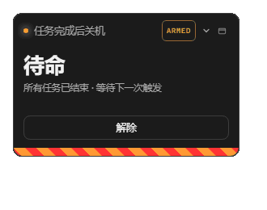</p>

不是右下角那个浮动按钮。卡片就长在侧边栏里，武装、倒计时、等待、暂停都写在卡片上，点一下就展开面板。

## 为什么需要它

跑长任务的人常有这个场景：晚上让 agent 把一批活干完，想让它干完就关机，人不在跟前。

但「任务结束」不等于「可以关机」——后台任务还在跑、会话报错了、agent 在等你回答问题、你在半路手动终止了……这些情况下关机全是事故。这个插件把这些情况逐个挡下来，只有真的可以关的时候才关。

## 功能

### 判定：什么时候才关

五个条件同时满足才下发 `shutdown /s`：

1. 已武装（你手动点的）
2. 当前没有倒计时在跑
3. 所有 root 会话都空闲
4. 没有运行中 / 停止中的后台任务（`blockOnJobs`，默认开）
5. 本批次没有会话报错（`onlyOnSuccess`，默认开）

缺任何一条都不关，并把原因写在卡片和设置页里。

### 五种运行状态

| 未开启 | 待命 | 等待后台任务 |
| :---: | :---: | :---: |
|  | 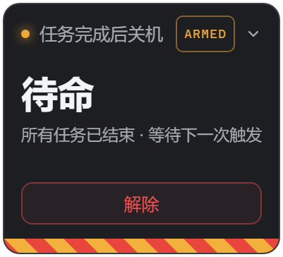 | 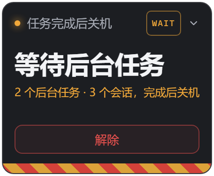 |

| 倒计时 | 已下发 |
| :---: | :---: |
| 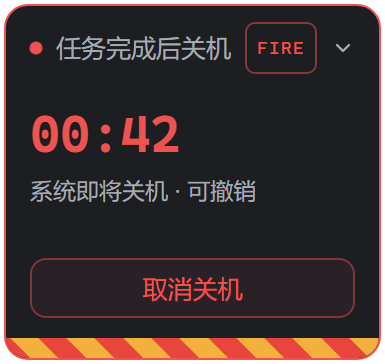 | 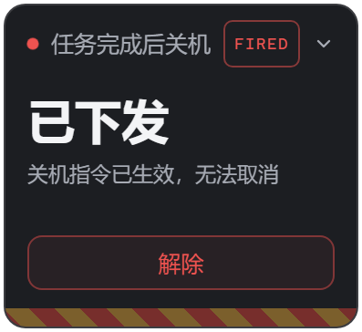 |

`未开启` → `待命` → `等待后台任务` → `倒计时` → `已下发`。倒计时期间随时可取消，取消后仍保持武装。

### 三种外观

| A · 警戒带 | B · 雷达 | C · 终端 |
| :---: | :---: | :---: |
|  | 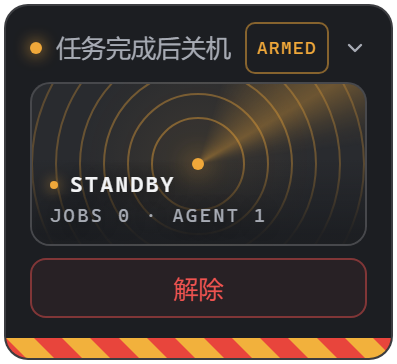 | 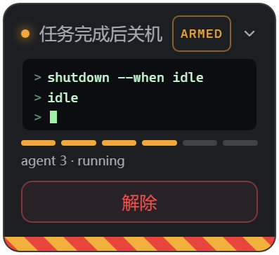 |
| 大字状态 + 底部滚动的红黄警戒条 | 同心圆 + 扫描光束，会话/后台任务以圆点呈现 | 命令行摘要 + 6 段判定条件指示灯 |

雷达里的圆点按数量增删、不重排，数量变化时你正在看的那几个点不会跳位置：

<p align="center">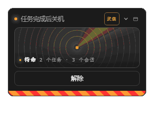</p>

设置里切换，立即生效，无需重启。

### 阻断态

| halted · 需人工处理 | waiting · 自动重试 |
| :---: | :---: |
| 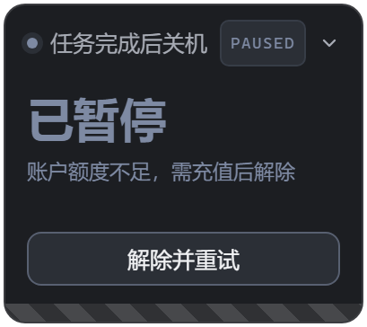 | 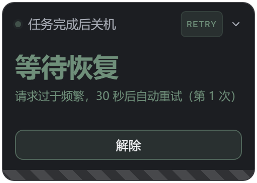 |

遇到没法当普通失败处理的错误，插件**不解除武装**，卡片转色、把原因写出来：

- **`halted`**（灰蓝）——额度不足、凭证失效、上下文超限、能力不支持、磁盘写满。只有人能处理，点「解除并重试」。
- **`waiting`**（灰绿，圆点呼吸）——限流、5xx、网络中断、空响应、超时、图片卸载。按策略自动重试，到点注入「继续原计划」指令。

<p align="center">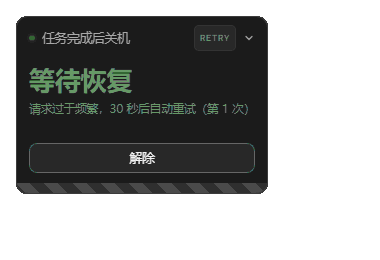</p>

重试节奏按故障类型分别配置，见 [重试策略](#重试策略)。

### AFK

人不在跟前时，插件替你顶三件事：

- **自动回答提问**（默认开）：agent 问你问题时，回复「用户处于 AFK，先完成已交代的任务，汇总报告并落盘，不碰未交代的分支」。返回 `selected: []` + 自定义文本，**不会替你选中任何选项**；关掉后提问照常抛给你。
- **错误恢复**：会话报错时先要求 agent 排查并继续原计划；同一会话再次失败改为「停止重试、写报告收尾」。
- **中断保护**：你在半路手动终止任务，不会触发关机。

### 其他

- **纵向折叠**：收起只留标题和状态，点标题展开。 
- **主题自适应**：卡片自带 `--dsp-*` 调色板，按宿主表面亮度自动取深浅色；也可强制锁定深色 / 浅色 / Claude Style 配色。
- **事件日志**：设置页里能看最近的事件与「上次为什么没关机」，完整流水在 `data/events.log`。

<br clear="all">

### 在侧边栏里的样子

| 武装 | 倒计时 |
| :---: | :---: |
| 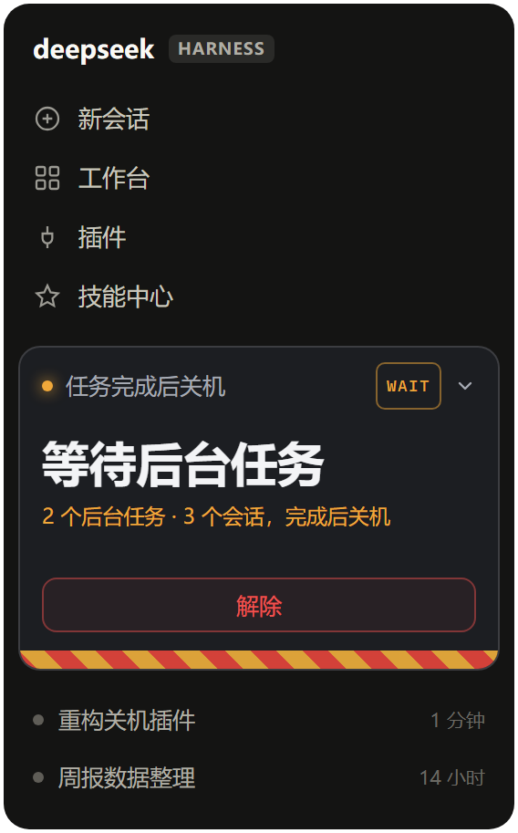 | 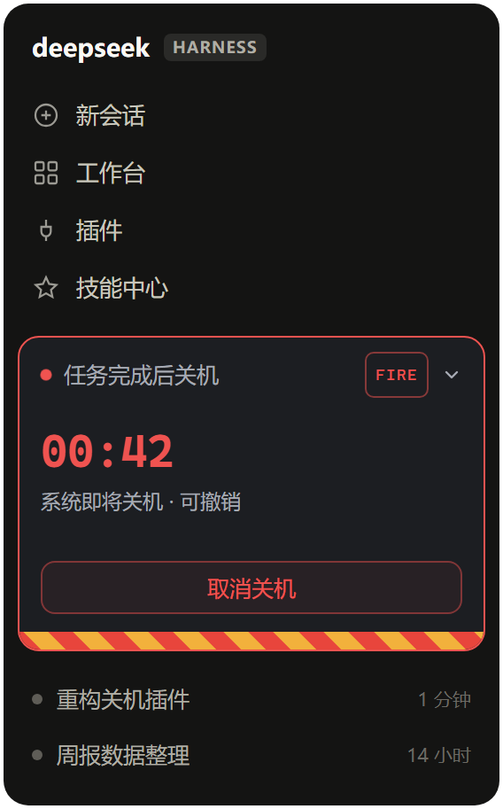 |

## 设置页

| 深色 | 浅色 |
| :---: | :---: |
| 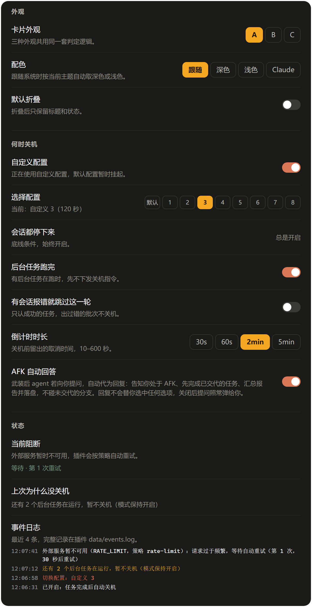 | 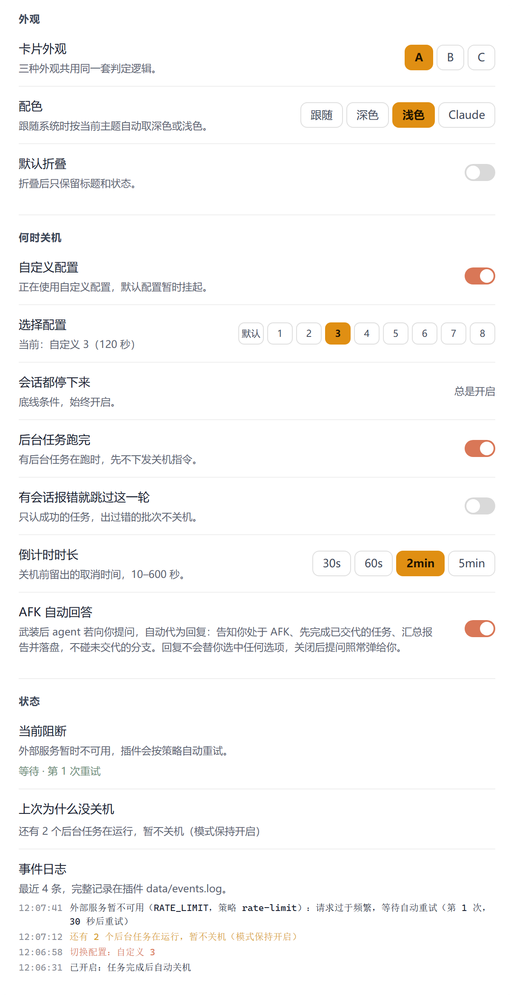 |

分三组：外观 / 何时关机 / 状态。所有开关立即生效。

- **默认配置**锁定 60 秒不可改；另有 8 个自定义档位可自由调。
- 「会话都停下来」是底线条件，始终开启，不可关。
- 「后台任务跑完」挡后台任务，「有会话报错就跳过这一轮」挡出错批次。

## 浅色与第三方主题

| 浅色卡片 | Claude Style |
| :---: | :---: |
| 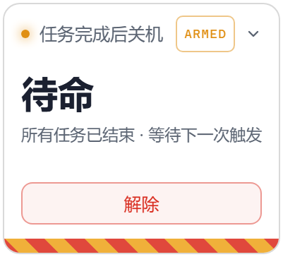 | 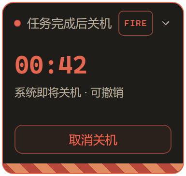 |

卡片不套用宿主配色，自带调色板；设置页则跟宿主主题走。第三方的 Claude Style 也有对应配色。

## 安装

**推荐**：DSH 设置 → 插件 → 添加，填入插件目录的**绝对路径** → 安装 → 重启 DSH。

**手工兜底**：在 `profiles\web` 下建 `node_modules\dsh-shutdown-guard` 软链指向本目录，然后在 `profiles\web\package.json` 里：

- `dependencies` 与 `pnpm.overrides` 加 `link:<插件绝对路径>`
- `dsh.profile.bundles` 追加 `dsh-shutdown-guard`

重启 DSH。

> ⚠️ **客户端 bundle 只在 DSH 启动时编入模块图**：改 `lib\client.js` 后必须重启，刷新页面无效。服务端同理。

## 配置

写在 `cordis.patch.yml`（插件包内的 patch），或经 `POST /config` 在运行时修改。

| 键 | 范围 | 默认 | 说明 |
| --- | --- | --- | --- |
| `countdownSec` | 10–600 | 60 | 关机前倒计时秒数（默认档固定 60，不可改） |
| `marginSec` | 0–60 | 5 | 传给 `shutdown /t` 的额外余量 |
| `onlyOnSuccess` | bool | `true` | 本批次有会话报错时跳过关机 |
| `blockOnJobs` | bool | `true` | 有运行中的后台任务时跳过关机 |
| `afkAutoAnswer` | bool | `true` | 武装期间替用户回答提问、做错误恢复 |

### 重试策略

每个错误码分配一个策略名，策略本身可配置：

| 策略 | 默认节奏 | 分配给 |
| --- | --- | --- |
| `rate-limit` | backoff 30 → 60 → 120 → 240 → 300 封顶 | `RATE_LIMIT` |
| `transient` | 固定 20 秒 | `SERVER` / `TRANSPORT` / `TIMEOUT` |
| `empty` | 固定 30 秒 | `EMPTY_RESPONSE` |
| `offload` | 固定 5 秒 | `IMAGE_OFFLOAD_REQUIRED` |

限流用退避而不是固定间隔，是因为对限流服务高频重试**会延长**限流期，而不只是浪费请求。5xx 和网络故障恢复时间可预测，固定间隔反而更快。图片卸载是本地磁盘操作，几乎立刻可重试，所以给 5 秒。

覆盖单个错误码：

```yaml
retryAssign:
  RATE_LIMIT: slow-limit
retryPolicies:
  slow-limit: { mode: backoff, base: 60, max: 900 }
```

未知 `code` 回落 `transient`；形状写错的策略会被丢弃并保留默认值。当前生效的分配可从 `/state` 的 `retryAssign`、`retryPolicies` 读到。

UI 偏好存在浏览器 `localStorage`：`dsh-shutdown-guard.variant` / `.theme` / `.folded`。

## HTTP 接口

前缀 `/api/dsh-shutdown-guard`，供卡片自己的同源轮询使用：

| 方法 | 路径 | 说明 |
| --- | --- | --- |
| GET | `/state?since=<ms>` | 完整状态 + 增量事件 |
| POST | `/arm` `/disarm` `/cancel` | 武装 / 解除 / 取消本次倒计时 |
| POST | `/config` | 改配置：`customEnabled`、`activeProfileId`、`profileId`+`patch`、`afkAutoAnswer` |
| GET | `/events?since=&limit=` | 事件流水 |

非本机 Origin 的 POST 返回 403；非 POST 返回 405。

## 日志

- `<插件目录>\data\events.log` —— 人类可读的事件流水（`config` / `afk` / `skip` 分类），设置页「事件日志」即读它
- `<DSH_HOME>\dsh-shutdown-guard.log` —— 进程级追加日志

## 开发

```bash
node test/host.test.mjs        # 服务端：27 项断言，mock ctx，不真的关机
node test/client.test.cjs      # 客户端 bundle smoke
node scripts/gen-gallery.cjs   # 从 lib/client.js 真实 CSS 生成截图页
pwsh scripts/screenshot.ps1    # headless Edge 渲染 PNG（透明背景 + 自动裁边）
node scripts/gen-gif.cjs       # 生成 README 里的三张动图
```

截图全部由 `lib/client.js` 里的真实 CSS 生成，不会与产品脱节。动图同理：把 CSS 动画用 `animation-delay` 冻结在若干时间点逐帧截图，再用内置的 GIF89a 编码器合成——本机不需要 ffmpeg 或 ImageMagick。

## 常见问题

**为什么改了设置没反应？**
服务端和客户端都得重启 DSH 才加载新代码。本机 HMR 对本地链接插件不生效。

**武装后为什么不关机？**
看设置页「上次为什么没关机」，那里写着具体原因（后台任务、报错、未武装等）。

**倒计时期间能反悔吗？**
能。卡片上的「取消关机」或直接 `shutdown /a` 都行，取消后仍保持武装，下一个批次继续生效。

**会误关机吗？**
默认配置下，插件要看到「所有会话空闲 + 没有后台任务 + 没有报错 + 你手动武装」四条同时成立才动手，其中任何一条被打破都会取消或跳过。手动终止任务也已被识别并排除。

**非 Windows 能用吗？**
不能，非 `win32` 平台直接早退不挂载。

## 约束

- 仅 Windows：非 `win32` 平台早退，不挂载。
- 零运行时依赖：服务端只用 `node:fs` / `node:path` / `node:crypto`，浏览器只 `require('react')`。
- 不修改 `app.asar` 与 DSH 源码。

## 许可

[MIT](LICENSE)

## 致谢

服务端判定逻辑复刻自 `dsh-shutdown-after-task@0.2.0`；UI 改为 DSH 客户端槽位注册，与原件的浮动按钮和 DOM 注入无关。
